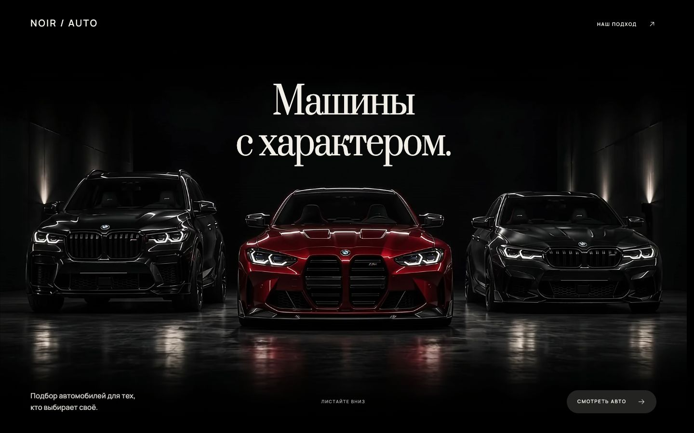

# NOIR AUTO

[Открыть демо на GitHub Pages](https://manath-iq.github.io/auto_pere/)



Демо первого экрана на React, TypeScript, Vite, GSAP ScrollTrigger и Tailwind CSS. После заставки открыт неподвижный кадр. Нативный скролл управляет пролётом к салону BMW в обе стороны. Затемнение переходит в финальный заголовок. Обе кнопки и верхняя ссылка ведут к секции «Не для каждого» (`#character`). В ней три BMW проходят над заголовком при прокрутке. На узком экране красный BMW занимает большую часть ширины, а боковые машины видны у краёв кадра.

## Запуск

```sh
npm ci
npm run dev
```

Для проверки production-версии выполните `npm run build`, затем `npm run preview`.

## Где менять

- `src/config.ts` — wordmark, тексты, якорь, путь к медиа и частота кадров.
- `src/HeroExperience.tsx` — компоненты сцены, интро и монтажная шкала GSAP. Позиции на шкале заданы долями от 0 до 1.
- `src/ClosingSection.tsx` — контактный блок и футер. В `destinations.contact` укажите адрес канала связи, в `destinations.catalog` — адрес или якорь опубликованного каталога. Ссылки Telegram, MAX и VK задаются в `socials`. Пустые значения сохраняют демонстрационный режим.
- `src/useScrollVideo.ts` — пересчёт прогресса в кадр и управление перемоткой. Пока декодер занят, сохраняется последняя запрошенная позиция.
- `src/style.css` — композиция, шрифты, мобильные размеры и статичный режим. Шрифты поставляются локально. Лицензии находятся в `public/fonts/licenses/`.

Траектории машин задаются в `src/PerformanceStatement.tsx`, размеры и расположение — в `src/performance-statement.css`. Для замены изображения обновите PNG и WebP с одинаковым именем в `public/media/statement/`.

## Видео и ограничения

Рабочие версии получены из локального исходника `hero_video.mp4`. В рабочей папке `public/media/hero/` лежат две версии H.264 без звука: 1920×1080 (4,86 МБ) и 960×540 (2,38 МБ), а также WebP первого и последнего кадров. Обе версии содержат 190 кадров, 24 кадра/с. Ключевой кадр каждые шесть кадров, без B-кадров, данные MP4 для начала чтения перенесены в начало файла. Сборка использует только рабочие ассеты.

На смартфоне в портретной ориентации кадр увеличен в 1,48 раза и центрирован на красной BMW. При reduced motion, ошибке видео или отсутствии первого декодированного кадра спустя 9 секунд видны постер и доступный обычной прокруткой финал. Заставка пропускается при reduced motion, при переходе по якорю и после первого просмотра во вкладке.

Проверка на компьютере с мобильным размером окна не измеряет скорость декодера iPhone, поведение адресной строки и энергосбережения iOS. Перед публикацией стоит проверить быстрые свайпы в Safari на физическом телефоне.


## Исходники BMW

Машины сгенерированы по отдельности встроенным ImageGen. Общий промпт для каждой версии:

> Product-mockup asset. One [car]. Photoreal automotive studio photography, direct overhead birds-eye shot with roof visible and FRONT HOOD FACING THE TOP OF THE IMAGE, symmetrical centered straight vertical axis, long body nearly fills portrait canvas with slim safe margin on all sides. Clean glossy metal, soft silver strip reflections over the fenders, clear windshield and sculpted hood details, black carbon roof. Isolated true transparent background outside silhouette. No floor, shadow plane, typography or scenery.

Варианты `[car]`: `black BMW M5 performance sedan`, `dark graphite grey BMW M4 performance coupe`, `deep crimson red BMW M3 performance sedan`.
